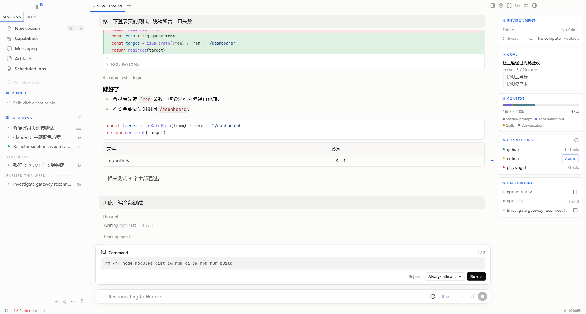

# Claude UI

Hermes Desktop 的主题插件。整体仍是 Hermes 的样子，在此基础上带入 [codex-ui](../codex/codex-ui) 的标志性处理。



## 设计

- **配色**
  - 中性色取 codex-ui 的暖调近白灰，描边细，几乎没有阴影。
  - 唯一的强调色是柔化过的 Hermes 蓝：亮色 `#1F5FE0`，暗色 `#7AA2FF`。
- **字体与圆角**
  - 字体沿用 Hermes 的 Segoe UI 和 JetBrains Mono。
  - 圆角取折中档：控件 4px，卡片和菜单 6px，输入框和停靠卡 10px。
- **保留的 Hermes 元素**：`HERMES AGENT` 字标、大写分组标题和 dither 方点、背景纹理、运行流光、状态栏。它们统一按新配色上色。
- **去掉的 Hermes 元素**：聊天区最上方的会话标签栏（连同「+」），那段标题栏仍可拖动窗口。新建和切换会话用左侧会话列表；多开的会话仍可用 ⌘1…⌘9、⌃Tab 切换。
- **codex-ui 的标志性处理**
  - **工具行**：一行灰字，格式为「动词 · 详情 · 结果 ›」，运行中整行扫光，连续多条调用合并成一行，展开后是细环卡片。
  - **工作行**：用 Hermes 的 dither 方块，加 codex-ui 的呼吸动画和扫光。
  - **提问卡、审批卡**：停靠在输入框正上方 6px 处，与输入框同宽，滚动时吸住不动。
  - **推理强度滑块**：输入框里的推理强度入口。分档拖拽，切换档位时档位名有过渡动画，并带 WebGL 充能场。
  - **额度用量环**：订阅或套餐的额度，不是上下文用量。点开可以看到各个额度窗口的用量和重置时间。
  - **会话栏**：停靠在聊天区右侧，包含环境、目标、上下文、连接器、后台五张卡。标题栏有开关；窗口窄于 1000px 时自动收起。
- **文案**：一律使用 Hermes 的官方文案。Hermes 里没有对应项的少数文案放在 `src/i18n.ts`，提供英文和中文。

## 安装

这个仓库是一个纯桌面插件，根目录的 `plugin.js` 就是成品：

```bash
npm install
npm run install-plugin
```

这条命令会构建插件，并复制到 `%LOCALAPPDATA%\hermes\desktop-plugins\claude-ui\plugin.js`；如果设置了 `HERMES_HOME`，则复制到 `$HERMES_HOME/desktop-plugins/claude-ui/`。Hermes 会自动加载它。

插件第一次启用时会切换到 Claude UI 主题。之后可以在 设置 → 外观 → 主题 里随时换回别的主题。

## 开发

```bash
npm run dev     # 监听源码，每次保存都构建并复制到 desktop-plugins，Hermes 会热重载
npm run build   # 只构建出 plugin.js
npm test        # node --test，覆盖额度数据整理与额度环的纯逻辑
```

- 源码在 `src/`。esbuild 把它打包成单文件 ESM，只保留 Hermes 允许的三个外部依赖：`@hermes/plugin-sdk`、`react`、`react/jsx-runtime`。构建脚本会检查这一点。
- `src/styles/*.css` 以文本形式打进主题的 `customCSS`。只有在本主题被绘制时，宿主才会注入这段 CSS。
- 自建组件（额度环、推理强度、会话栏）同样只在本主题激活时出现。

## 已知限制

- 冷启动时会先闪一下 Hermes 默认主题。原因是插件主题不会被缓存，SDK 也没有提供绕开的办法。
- 代码语法色（Shiki）和 Windows 原生窗口按钮无法换肤。
- 提问卡不分页，因为 Hermes 是一次列出所有问题。审批卡中间的按钮仍是 Hermes 的「始终允许…」下拉。
- 新对话在还没有会话时，推理强度用的是 Hermes 原生入口，因为这时写入会改到全局配置。另外，滑块的改动不会写进 Hermes 的"按模型记忆的预设"。
- 工具摘要行（例如 "Explored 3 files, ran 1 command"）的措辞在 Hermes 里是写死的英文。
- 停靠卡的对齐依赖 Hermes 当前的版式数值：内容列内边距 24px、输入框内缩 1rem、滚动条槽位 8px。Hermes 改版后可能需要跟着调整。

## 卸载

删除 `%LOCALAPPDATA%\hermes\desktop-plugins\claude-ui\`，或者在 能力 → 插件 里把它关掉。
